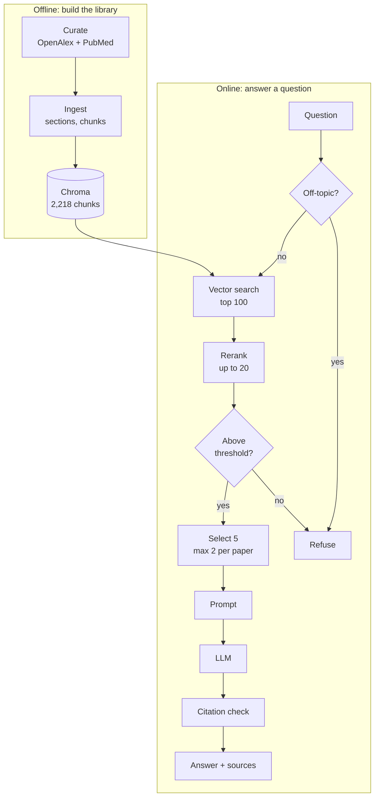

# ScienceFit

ScienceFit is a RAG chatbot I built to answer resistance-training questions from a curated library of peer-reviewed papers. The model sees only retrieved passages, is told to cite every claim with a paper ID, and each ID is checked against what was retrieved. If no passage clears a relevance threshold, it refuses without calling the model. The library is 23 open-access papers (2,218 chunks). On a 7-question smoke test with `gpt-oss-120b`, 0 of 7 answers were judged wrong (3 good, 4 ok). It runs on an 8 GB MacBook Pro (M3) with a local 3B model, and any OpenAI-compatible model works through 3 `.env` settings.



## How it got here

| Iteration | Main change | Answers judged wrong (7 questions) |
|---|---|---|
| 1 | Cross-encoder reranker, refusal threshold, citation validator, curated papers (`llama3.2:3b`) | not scored on these questions |
| 2 | Section labels, contextual headers, per-paper caps, allowed-ID list (`llama3.2:3b`, prompt v1) | 3 / 7 |
| 3 | Generic LLM client, `gpt-oss-120b`, prompt v2 | 0 / 7 |

Seven questions is a smoke test, not a benchmark. The grades predate the latest re-ingest (better section labels, study designs from PubMed). A larger retrieval eval (recall, MRR) is next.

## Quick start

You need Python (developed on 3.13) and [Ollama](https://ollama.com) running.

```bash
git clone https://github.com/rbhaskar-kosuru/ScienceFit.git && cd ScienceFit
python3 -m venv .venv && source .venv/bin/activate
pip install -r requirements.txt
ollama pull llama3.2:3b && ollama pull nomic-embed-text

python -m src.curate      # find papers, download open-access PDFs
python -m src.ingest      # build the index

uvicorn src.api:app       # terminal 1
streamlit run app.py      # terminal 2 (same venv)
```

One curate run downloads up to 20 PDFs, so your library will differ from mine. The first API start downloads the reranker from Hugging Face. No `.env` is needed for a local run.

To use a hosted model, put this in `.env` (see `.env.example`) and restart the API:

```bash
LLM_BASE_URL=https://api.groq.com/openai/v1
LLM_MODEL=openai/gpt-oss-120b
LLM_API_KEY=gsk_...
LLM_PROMPT_VERSION=v2     # optional; the default is v1
```

The question and the retrieved passages are then sent to that provider. Embeddings and reranking stay local.

All settings: [docs/configuration.md](docs/configuration.md). Endpoints: [docs/api.md](docs/api.md).

## How it works

1. **Curate** (`src/curate.py`). Searches OpenAlex with 8 queries, drops off-topic papers, scores the rest (40% citations, 35% study design, 25% journal) and keeps those at 0.65 or above with a valid PDF. Study design comes from a title that declares it, then PubMed publication types, then keywords. The title goes first because PubMed tags a narrative review in this library as a meta-analysis.
2. **Ingest** (`src/ingest.py`). Strips front matter and references, labels sections, and cuts 800-character chunks that never cross a section. Each chunk is embedded with its paper title and section, because "we found…" means little without them. The index is built in a staging collection and swapped in, so a failed run keeps the old one.
3. **Retrieve** (`src/rag.py`, `src/rerank.py`). Vector search returns the 100 closest chunks, at most 4 per paper go on, and a cross-encoder reranks up to 20. Vector search matches topic; the cross-encoder reads question and passage together, so it ranks passages that answer the question higher. Introductions rank lower, because they mostly describe other studies.
4. **Answer** (`src/prompts.py`, `src/llm.py`). The top 5 passages, at most 2 per paper, go to the model with a list of allowed citation IDs. Passages carry an ID and a section but no title, so there is no header to copy. With no passage above the threshold, the model isn't called.
5. **Verify** (`src/rag.py`). Every cited ID is checked against the retrieved papers. IDs that weren't retrieved and author-style citations are flagged, and an answer that cites none of its sources gets a warning. This checks IDs, not whether the passage supports the claim.

## Evaluation

`python -m evals.run_smoke` runs 9 questions: 7 to answer and 2 that must be refused.

- **Auto-check:** passes if the answer cites at least one expected paper, or refuses when it must. It can't tell whether the claims are right: `gpt-oss-120b` passes 9 of 9 with prompt v2 and with v3 to v5.
- **Grading:** each claim in the 7 answers was graded by an LLM (Claude) against the passages the model saw, and each answer rated good, ok or bad. I spot-checked 5 grades and agreed.

| Model | Prompt | Good | Ok | Bad |
|---|---|---|---|---|
| `llama3.2:3b` | v1 | 0 | 4 | 3 |
| `llama3.2:3b` | v2 | 0 | 2 | 5 |
| `gpt-oss-120b` | v1 | 3 | 4 | 0 |
| `gpt-oss-120b` | v2 | 3 | 4 | 0 |

Retrieval was identical across all four, one graded run each. With v1, `gpt-oss-120b` first passed 4 of 9 on the auto-check because it wrote `【id】` instead of `[id]`; the validator now normalises that. I use `gpt-oss-120b` with v2 when hosted (no author names in either v2 run) and the 3B model with v1 locally. Prompts v3 to v5 stay opt-in: v3 and v4 read more easily but combined numbers from passages (v4 scored 3 good, 3 ok, 1 bad), and v5 marks second-hand evidence but still presents one narrative review as a finding.

## Project structure

```
app.py                   Streamlit UI
src/config.py            settings and their defaults
src/curate.py            OpenAlex search, relevance gate, study design, scoring, PDF download
src/manifest.py          list of judged papers, shared by curate and ingest
src/ingest.py            PDF text, section labels, chunks, embeddings, Chroma
src/rerank.py            cross-encoder
src/rag.py               retrieve, refuse, generate, validate citations
src/prompts.py           prompts v1 to v5
src/llm.py               OpenAI-compatible client
src/redact.py            strips API keys from error text
src/api.py               FastAPI: /ask, /health
evals/run_smoke.py       smoke eval
evals/smoke.json         questions and expected papers
evals/*.txt              saved answers from earlier runs
evals/runs/              outputs with paper passages (gitignored)
tests/conftest.py        blanks .env settings, blocks the network
tests/test_pipeline.py   curation, ingest, retrieval, citations
tests/test_sections.py   section labels, second-hand flag
tests/test_design.py     study design
tests/test_llm.py        LLM client, prompts, eval output
tests/test_secrets.py    no key in errors, output, logs or tracked files
docs/                    configuration and API reference
```

Run `pytest` (236 tests, no network). API keys live only in `.env` and are sent in headers; the tests scan the repo for anything key-shaped.

## Limitations

- A narrative review's summary of other studies can still be presented as its own finding.
- The library is small: 23 papers, open access only. Not medical advice.
- The hosted model runs on a free tier with rate limits, and repeated runs differ even at temperature 0 with a seed.
- Citation checks verify IDs, not claims. Claim verification is planned.
- Models sometimes combine numbers from a passage into one it doesn't state.
- No conversation memory: each question stands alone.
- The UI is a prototype.

## Roadmap

- Retrieval eval with more questions (recall, MRR) and exact vector search.
- Second-hand label per source in the API.
- Number check, as part of claim verification.
- Rank penalty for second-hand passages, measured by the retrieval eval.
- Conversation memory, then deployment.

## Acknowledgements

[OpenAlex](https://openalex.org), [PubMed / NCBI E-utilities](https://www.ncbi.nlm.nih.gov/books/NBK25501/), [Ollama](https://ollama.com), [Groq](https://groq.com), [ChromaDB](https://www.trychroma.com), the authors of [cross-encoder/ms-marco-MiniLM-L-6-v2](https://huggingface.co/cross-encoder/ms-marco-MiniLM-L-6-v2), and the authors of the papers in the library. The papers themselves are not in this repo.

## License

MIT. See [LICENSE](LICENSE).
